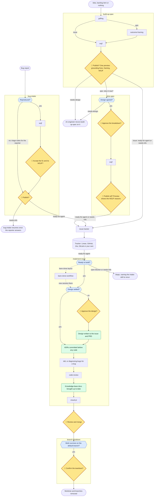

# katana-sdlc-skills

Skills to power up your repo with AI-driven SDLC.

Agent skills, distributed with [APM](https://github.com/microsoft/apm) so consuming repos get
**pinned, reproducible, reviewable** versions instead of copy-pasted markdown.

## Install

Each skill is installed on its own by its subpath, so you cherry-pick what you want. Most skills also
need **wiring** into your repo's `AGENTS.md` / `CLAUDE.md` before agents use them; `setup-katana-skills`
does both.

### Recommended: let setup pick, install and wire

Add the setup skill to your `apm.yml`, install, then run it:

```yaml
dependencies:
  apm:
    - git: Meito-ai/katana-sdlc-skills/src/skills/setup-katana-skills
      ref: v0.2.4        # or "^0.2.0" on apm >= 0.16.0
```

```bash
apm install
# then, in Claude Code:  /setup-katana-skills
```

It detects the katana skills you already have, offers the rest, installs your picks at the same `ref`,
and writes one `## Katana skills` block into `AGENTS.md`, and into `CLAUDE.md` unless it references
`AGENTS.md` — nothing else. Picking
`bare-clone-workflow` also converts your clone to the bare-clone layout (after asking). Nothing is
committed. Re-run it to add or remove skills.

### By hand

Reference each skill you want by its subpath:

```yaml
dependencies:
  apm:
    - git: Meito-ai/katana-sdlc-skills/src/skills/sdlc/branch-management/bare-clone-workflow
      ref: v0.2.4
    - git: Meito-ai/katana-sdlc-skills/src/skills/sdlc/branch-management/branch-shutdown
      ref: v0.2.4
```

```bash
apm install
```

Then run `/setup-katana-skills` to wire them, or write the wiring yourself.

Skills deploy to `.agents/skills/` and, if you target `claude`, `.claude/skills/`.

A bare repo-root reference (`- git: Meito-ai/katana-sdlc-skills`) installs **nothing** — pick the
skills you want explicitly.

### Requirements

- **apm >= 0.16.0** to use a semver `ref:` range; **0.32.x** recommended and what CI verifies.
- Commit your `apm.lock.yaml` and run `apm install --frozen` in CI, so a new upstream tag can never
  enter a build without a visible lockfile diff.

## How the skills fit together

The skills under [`src/skills/sdlc/`](./src/skills/sdlc) form one flow, from an idea or a bug report to
a merged PR and a retired branch. Each box is a skill, holding its steps:

- **👤 Amber diamonds** are the human gates: the flow waits for your approval there.
- **Blue hexagons** are checks the skill makes itself; it routes the item or stops.
- **Green boxes** are what the skill records: the design, ADRs and docs.
- **Dashed boxes** are upstream skills the flow invokes.
- **Edge labels** are the tracker labels an item carries along that edge.

<!-- sdlc-flow:start -->

<!-- sdlc-flow:end -->

## Skills

Each skill lives at [`src/skills/`](./src/skills).

<!-- skills-table:start -->
| Skill | What it does |
|---|---|
| [`bare-clone-workflow`](./src/skills/sdlc/branch-management/bare-clone-workflow) <!-- stamp: 1ba92cc3581b --> | Git bare-clone worktree layouts: a container directory holding `.bare`, one sibling worktree per branch, no primary checkout. Clones into the layout, converts an existing clone, adds worktrees. |
| [`branch-shutdown`](./src/skills/sdlc/branch-management/branch-shutdown) <!-- stamp: f122a7c7da68 --> | Retires a merged or abandoned branch. Fetches from the remote and proves the work survives on the default branch — including squash-merges — before deleting the worktree, the local branch or the remote branch. |
| [`visual-pr`](./src/skills/sdlc/code-review/visual-pr) <!-- stamp: ca986d3a46a4 --> | Writes the PR description a reviewer reads first: a visual of the change (a Mermaid diagram, a control-flow or file-tree diff), before/after evidence, and merge danger. Kept in one marked block stamped with the PR head sha and refreshed after every push; text outside the block is left alone. A bundled Claude Code hook flags a description left stale by a push. Inspired by the [`pr` skill](https://github.com/mattpocock/skills/tree/v1.3.1/skills/engineering/pr) in `mattpocock/skills`. GitHub only; needs `gh` and Node.js >= 20 on the machine, but not a Node repo. |
| [`outcome-framing`](./src/skills/sdlc/feature-management/outcome-framing) <!-- stamp: 29957d7a9fd8 --> | Refines an epic into outcome framing: classifies it as product, tech or compliance and on the Input-to-Impact ladder, flags prescriptive language, and rewrites its title and description around a measurable result (a KPI, a DORA metric, a fitness function, or a met obligation), confirmed with you in one round. |
| [`issue-tracker`](./src/skills/sdlc/feature-management/issue-tracker) <!-- stamp: 43f49f896fab --> | The one way the SDLC skills read and write your tracker: eleven operations (fetch, search, create, update, comment, labels, the epic's PRD, close as duplicate, the frontier, the PR link), each with a text fallback such as `Blocked by:` lines or a `# Spec` section where the tracker lacks it. Ships adapters for Linear, GitHub, Jira Cloud and GitLab (Free and Premium); `setup-katana-skills` writes one for any other tracker. Keeps the tracker's coordinates out of a public repo's committed files. |
| [`wsjf`](./src/skills/sdlc/feature-management/wsjf) <!-- stamp: 6c92a4628f57 --> | Scores and ranks epics and issues (product, tech, compliance and bug fixes) by WSJF: cost of delay ((value + risk reduction/opportunity enablement) × time criticality) over job size, each a Fibonacci score relative to already-scored items. Calibrates a reference set on a cold start, ranks with a bundled dependency-free script, and writes a `## WSJF` block back to the tracker after one round of verification. When another skill is drafting the item, the block goes back to it unverified and that skill's preview shows the reasons instead, so you are asked once. Needs `issue-tracker`. |
| [`build-up-spec`](./src/skills/sdlc/feature-management/build-up-spec) <!-- stamp: 5d9037239df5 --> | User-invoked (`/build-up-spec`). Turns an idea, a raw backlog item or nothing at all into an **epic** (an issue card plus an attached PRD) or an **issue** one agent session can finish. Explores the repo, searches the tracker for duplicates, grills you on the scope, writes EARS requirements, then hands off to `outcome-framing` and `wsjf` before publishing. Every fact is sourced or left as a placeholder. A product owner can defer the design to the engineer: the item is then published `needs-design` until an engineer refines it. Installs `grilling` from `mattpocock/skills` with it, and needs `outcome-framing`, `wsjf`, `slice-spec` and `issue-tracker`. |
| [`slice-spec`](./src/skills/sdlc/feature-management/slice-spec) <!-- stamp: 155de9ae2c62 --> | Slices an epic into tracer-bullet issues sized for one fresh agent session, each covering requirements from the epic's PRD, with EARS acceptance criteria, blocking links, and WSJF for the slices that deliver value on their own. Refuses an epic still labelled `needs-design`. Adapted from `to-tickets` in `mattpocock/skills`. Needs `wsjf` and `issue-tracker`. |
| [`bug-intake`](./src/skills/sdlc/feature-management/bug-intake) <!-- stamp: 208ebb0f8397 --> | User-invoked (`/bug-intake`). Turns a bug report (free text, a tracker item or a URL) into an issue one agent session can fix: checks for duplicates and behaviour that already works, reproduces the bug, rates its severity, and publishes the confirmed reproduction, the fixed behaviour, the seam the failing test attaches at and EARS criteria, labelled `ready-for-agent`. When the report can't be reproduced it labels the issue `needs-info` and posts triage notes for the reporter, which a later run resumes from. Root-cause diagnosis stays with the implementer. Adapted from `triage` in `mattpocock/skills`. Needs `slice-spec`, `wsjf` and `issue-tracker`. |
| [`implement-issue`](./src/skills/sdlc/implementation/implement-issue) <!-- stamp: 944bb2144f28 --> | Takes one issue to an open PR. Stops while a blocker is open or the criteria hold a placeholder, then judges whether the design is settled; when it is not, drafts the key interfaces, testing seams and ADRs, and writes nothing until you approve them. Builds test-first at the issue's testing seams (a bug starts from its reproduction), runs `code-review` against the issue, updates the docs the change made stale, and opens the PR (a merge request on GitLab). A trivial change described in text needs no issue. Adapted from `implement` in `mattpocock/skills`. Needs `issue-tracker`. Installs `tdd`, `code-review`, `codebase-design` and `diagnosing-bugs` from `mattpocock/skills` with it; uses `bare-clone-workflow`, `visual-pr` and `slice-spec` when installed. |
| [`paas-pulumi-infra-setup`](./src/skills/paas/paas-pulumi-infra-setup) <!-- stamp: 21308088a679 --> | User-invoked (`/paas-pulumi-infra-setup`). Interviews you and scaffolds the infra layer of a home-grown PaaS with Pulumi in TypeScript: server groups, private network, firewalls and static IPs on one of ten providers, with stacks, unit tests, an optional CI workflow and a runbook. Node.js repos; never deploys. Installs `pulumi-overview`, `pulumi-best-practices` and `pulumi-component` from `pulumi/agent-skills` with it. |
| [`setup-katana-skills`](./src/skills/setup-katana-skills) <!-- stamp: 1a20eb2833f5 --> | User-invoked (`/setup-katana-skills`). Picks which of the above this repo uses, installs them with apm, and wires each into `AGENTS.md` / `CLAUDE.md`: the tracker (checked before it is recorded), the knowledge base and the checks. Picking `bare-clone-workflow` also converts the clone to the bare-clone layout, after asking. |
<!-- skills-table:end -->

`bare-clone-workflow` and `branch-shutdown` are designed as a pair but each works installed alone.
Both are repo-agnostic: they detect the default branch, detect the VS Code workspace file if the repo
uses one, and defer to the host repo's own `AGENTS.md` for its install command and untracked files.

> Some skills declare upstream dependencies (e.g. on
> [`mattpocock/skills`](https://github.com/mattpocock/skills)). APM installs those transitively, but
> **a pin you already have for the same upstream repo wins silently** — so each skill also states
> its requirement in prose at the top of its own `SKILL.md`. Read it if a skill misbehaves.

## Contributing

See [AGENTS.md](./AGENTS.md) — it documents the repo layout, the two non-obvious ways a skill can
silently fail to publish, and the release flow. In short:

```bash
mkdir -p src/skills/<category>/<name>
$EDITOR src/skills/<category>/<name>/SKILL.md
$EDITOR apm.yml             # add: - ./src/skills/<category>/<name>   (so it loads locally)
npm run validate-skills     # catches frontmatter + wiring mistakes CI would reject
apm install                 # deploy locally and try it
$EDITOR README.md           # its row, and its place in the flow if under sdlc/
npm run readme:stamp        # the check CI and the Stop hook run
npm run changeset           # describe the change
```

## License

[MIT](./LICENSE)
